<p align="center">
  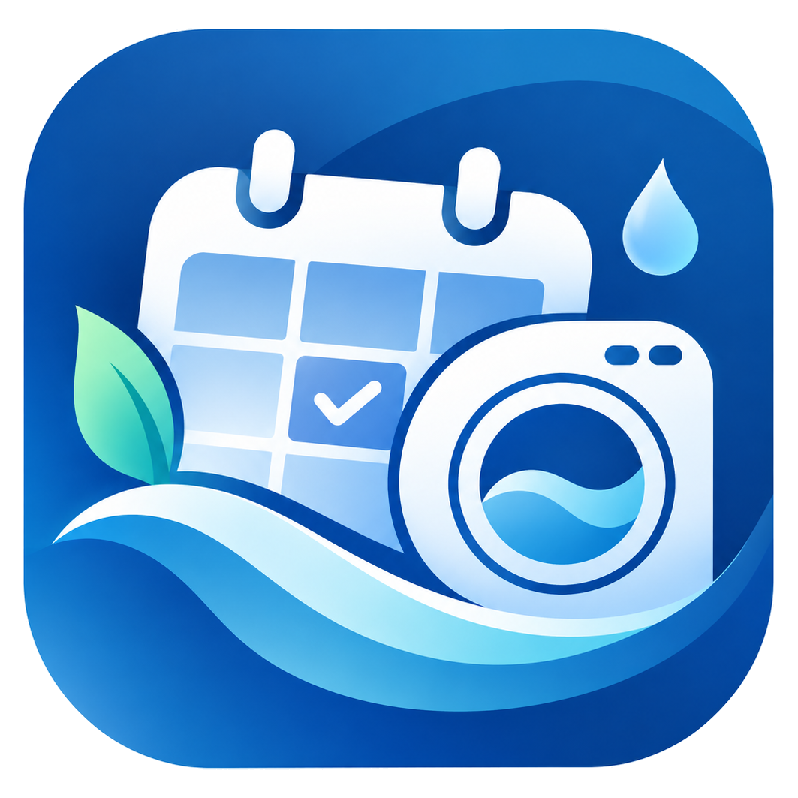
</p>

<h1 align="center">泥石</h1>

<p align="center"><strong>校园大小事，泥石搞定。</strong></p>

泥石是一款面向郑州师范学院学生的校园生活聚合应用，可以查看课程表、查询学业成绩与绩点、汇总学习通通知与待办、给课程记笔记，也可以启动校园饮水设备、扫码使用校园自助洗衣机并查询宿舍电费。

| 课程 | 服务 | 学习 |
| :---: | :---: | :---: |
| 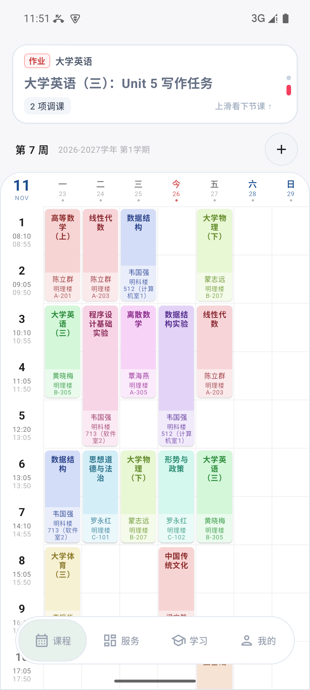 | 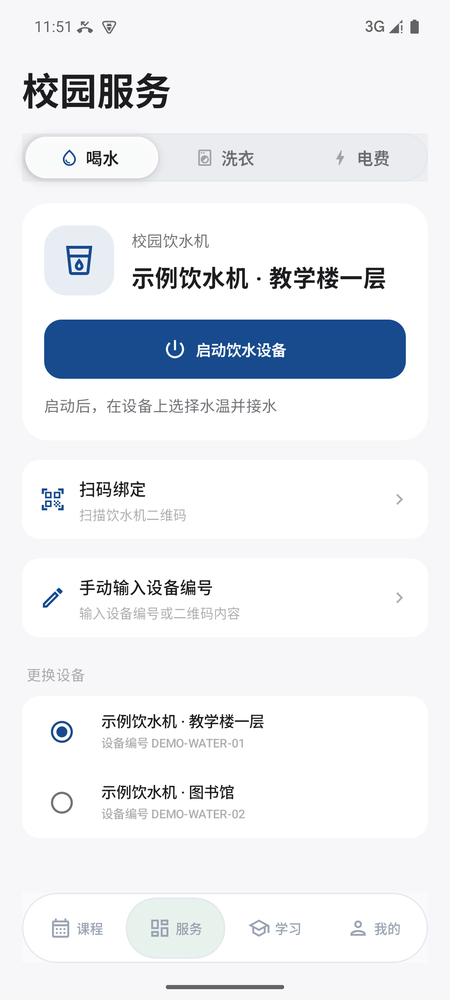 | 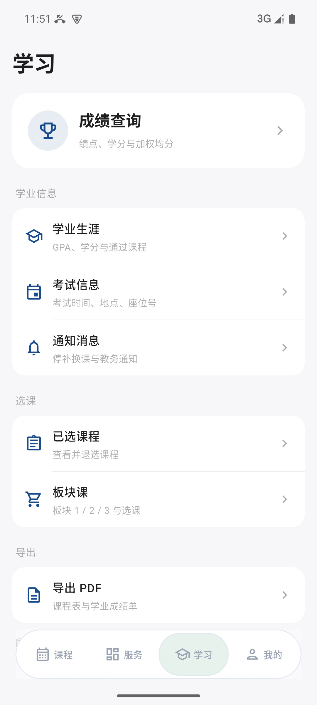 |

课程、服务、学习及深色课表截图均来自离线 Demo 的 Android 模拟器，使用虚构数据，不是真实用户设备截图。


## 功能

- **自动更新的课程表**：默认登录教务账号后自动同步课程表。显示课程时间、教师、教室及下一节课倒计时。
- **学业成绩**：底部「学习」页提供成绩查询，复用已登录的教务会话，读取当前学期成绩、学分和绩点；没有成绩时显示诚实的空状态。密码不保存，成绩数据只保存在本机。
- **教务学习工具**：「学习」页提供学业生涯、考试信息、通知消息、已选课程、板块课与 PDF 导出；不再提供个人信息工具。教务账户入口位于「我的 → 校园服务账户」。
- **宿舍电费**：「服务」页与喝水、洗衣并列，使用初始化登录时保存的教务学号查询房间余额与用电量，支持缓存和低电提醒，不要求重复绑定学号。
- **学习通通知中心**：登录学习通后自动抓取作业、签到与课程公告，归并成待办、课表异动与通知原文三页，支持后台提醒、关键字搜索与归档。
- **课程笔记**：在课程详情里记作业、课堂笔记与考点，支持图片和定时提醒，到点发系统通知。
- **手动添加课程**：直接在课表网格上点选与拖拽排课，不用逐项填表单。
- **饮水设备**：一键式，零广告的启动饮水机。
- **洗衣服务**：手机号验证码登录、扫码查看洗衣机、选择洗衣模式、支付宝支付与历史订单，整合自 `Night-stars-1/wash`。
- **桌面组件**：提供 2×2 的「下一节课」和 4×2 的「下一节课 · 今日概览」，根据上课、课间、课程结束和无课状态切换显示。

| 深色课程表 |
| :---: |
| 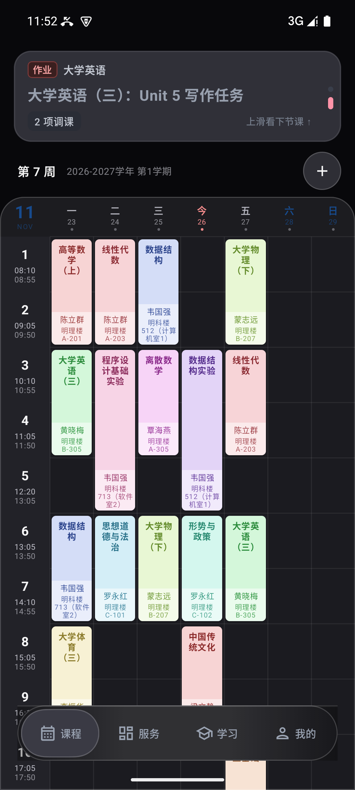 |

## 使用

运行环境为 Android 8.0（API 26）及以上。当前 Release 构建仅包含 `arm64-v8a`，适用于 64 位 ARM 设备。

### 初次设置与课表同步

1. 打开应用，按「欢迎 → 教务 → 服务 → 偏好 → 完成」进行初次设置。
2. 使用学号和教务密码登录，等待首次课表获取完成。
3. 核对「第一周第一天」、学期周数和上课时间，再按需要开启周末显示。
4. 在「我的 → 同步与数据」查看同步状态、手动同步或打开「课程表洞察」。

开启自动更新需要在教务登录时勾选「记住密码并自动更新课表」。后台任务按 6 小时间隔调度，实际执行时间受网络和系统后台限制影响。

| 欢迎与设置流程 | 课表偏好 | 同步与数据 |
| :---: | :---: | :---: |
| 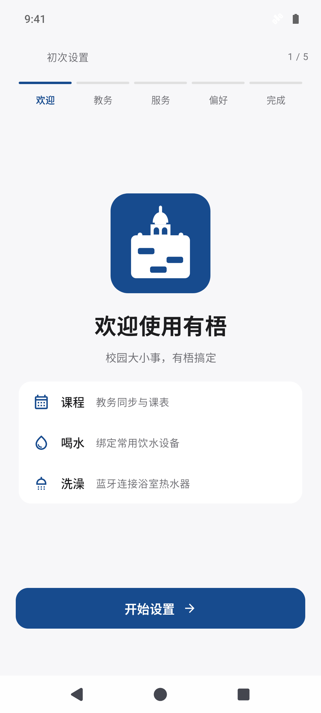 | 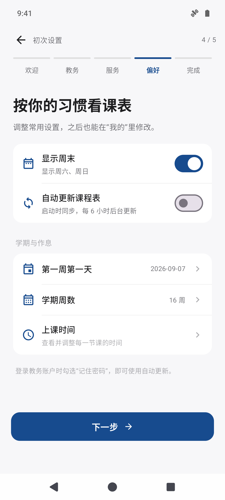 | 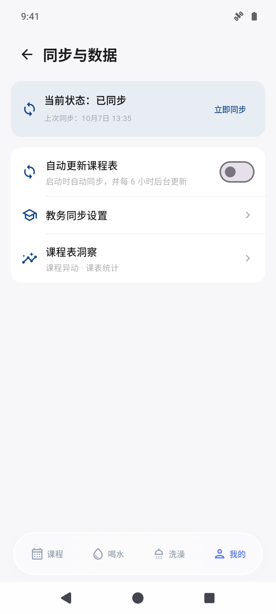 |

默认课表来源是教务直连：登录郑州师范学院教务账号后自动读取课表与成绩；学习通保留为备用登录方式。

登录页和「我的 → 同步与数据」保留「使用教务网页登录导入」作为备用。网页导入基于 `IMSX3D/Classy` 的 WebView 思路：直接打开郑州师范学院教务登录页，用户完成登录后，在已登录的 Cookie 会话中请求个人课表 `kbList`，不需要维护学校列表。

学习通账号密码使用 Android Keystore 管理密钥，通过 AES-GCM 加密保存在本机；网页导入只保留网页 Cookie，不保存教务密码。

### 服务与账户

教务、学习通、喝水和洗衣使用各自的账户，需要分别登录。教务与学习通账户可在初次设置或「我的 → 校园服务账户」中管理。

| 服务 | 登录与绑定 | 使用方式 |
| --- | --- | --- |
| 喝水 | 手机号、图形验证码和短信验证码；扫码或输入设备编号绑定 | 选中默认设备，点击「启动饮水设备」，随后在饮水机上选择水温并接水 |
| 洗衣 | 手机号与短信验证码；扫码或从最近使用的设备进入 | 选择洗衣模式并完成支付宝支付，随后按洗衣机面板提示操作 |
| 电费 | 复用初始化登录保存的教务学号 | 查看房间剩余电量、已用电量与供电状态；低电时可收到本地通知 |

扫码需要相机权限。设备控制依赖当前适配的校园服务和设备协议；电费接口是否可用取决于学校当前服务。

### 学习通课表与通知

学习通账户与喝水、洗衣账户相互独立，可在初次设置的「服务」步骤或「我的 → 校园服务账户」中登录。登录后会在登录页自动导入学习通中的课程表，也可在「我的 → 同步与数据 → 从学习通导入课表」手动刷新。登录使用学习通手机号与密码；若平时只用短信登录，需要先在官方 App 设置密码。

- **首页卡片**：默认展示最新未读通知；距下一节课 30 分钟内自动切换到课程模式，也可上下滑动或点右上角胶囊切换。两种视图行高一致，切换时版面不跳动。
- **待办**：同一份作业被重复提醒多次只占一张卡，标出提醒次数并显示最近一次时间；作业与考试分别按截止时间倒计时。
- **课表异动**：调课、互调、停课与「另行通知」类公告分四类呈现。写明「改到哪天第几节」的公告可直接点「改课表」，进入时新时间与新教室已预填在课表网格上。
- **通知原文**：可按未读、作业/测验、签到、课程公告筛选，也可用关键字搜索；点击通知原地展开全文、截止时间与学习通跳转入口，支持归档。
- **后台提醒**：默认每 30 分钟检查一次新通知，首次登录只建立基线，不会为历史未读批量推送。Android 13 及以上会在登录后请求通知权限。
- **本地已读**：「全部已读」与归档只覆盖本机显示，不回写学习通服务端，避免影响官方 App 的未读状态。
- **数据范围**：只读取通知中心（作业、考试、教师与学校通知，课程公告会混在其中）；私信（IM）没有可用接口，不包含在内。

| 待办 | 课表异动 | 通知原文 |
| :---: | :---: | :---: |
| 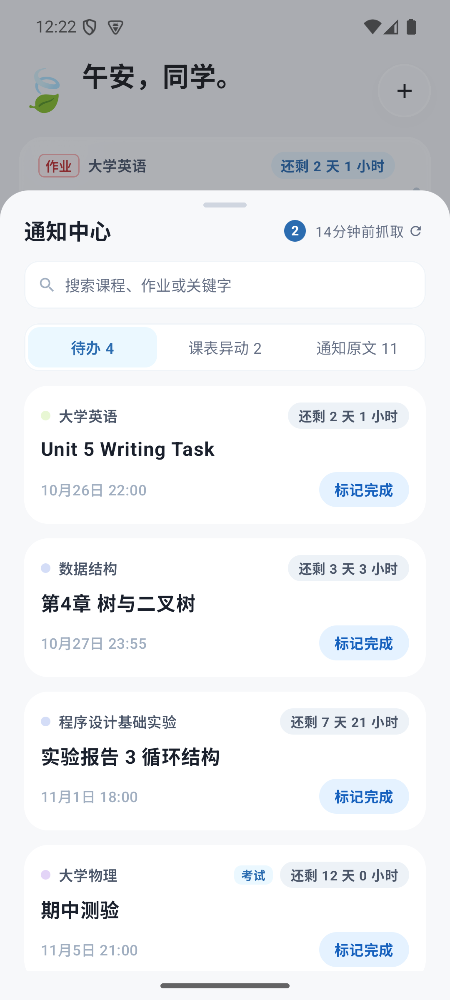 | 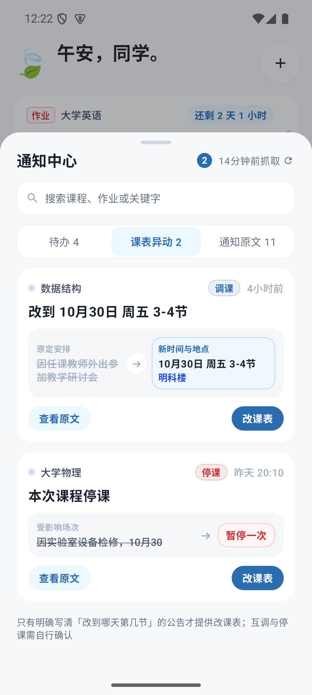 | 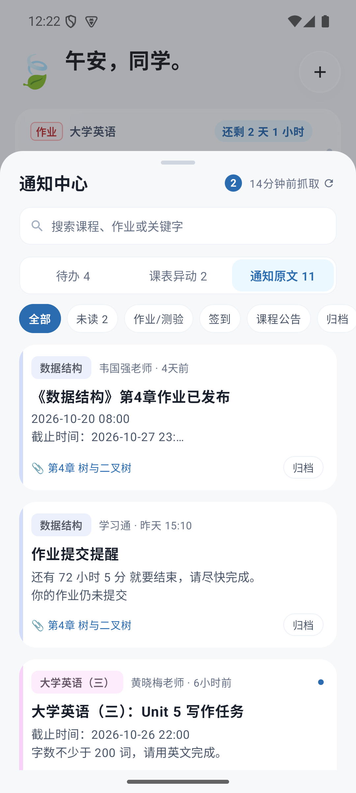 |

学习通密码和 Cookie 使用 Android Keystore 加密保存在本机；网络请求只读取通知列表，不执行签到或提交作业。

### 课程笔记

在课程表点任意一门课进入课程详情，即可在下方「课程笔记」里记作业、课堂笔记与考点。

- **三种类型**：同一条笔记可标为作业、笔记或考点，用颜色区分，列表按提醒时间与更新时间排序。
- **文字与图片**：可以写正文，也可以从相册插图；图片会复制到应用私有目录，原图被删也不影响。
- **查看与编辑分离**：点列表项先进入只读查看页，图片能正常查看；需要修改时再点编辑。
- **提醒**：可选「今晚 20:00」「明天 8:00」「后天 8:00」「本周末」等快捷时间，也可自定义日期与时间。到点发一条系统通知，点通知直接回到该课程详情。

| 课程详情与笔记 | 笔记编辑 | 自定义提醒 |
| :---: | :---: | :---: |
| 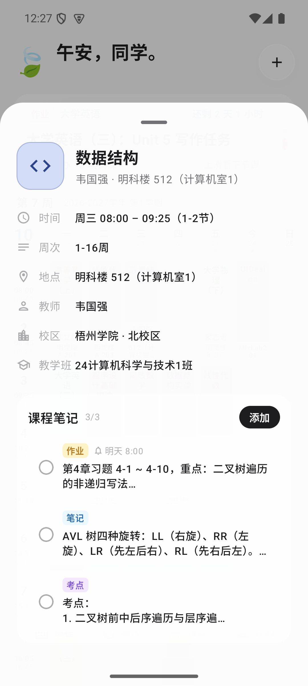 | 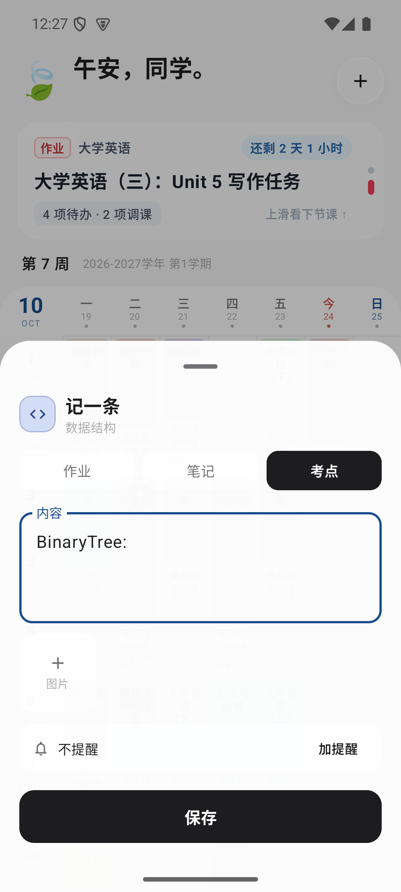 | 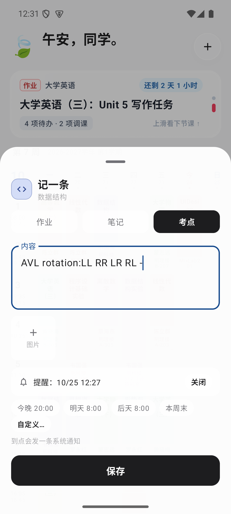 |

笔记提醒使用精确闹钟实现；未授予精确闹钟权限时自动退化为非精确闹钟，不会静默失败。笔记与图片只保存在本机，不会上传。

### 手动添加课程

点课程表右上角「＋ → 添加课程」进入画布排课模式，直接在网格上排课，不再逐项填表单。

- 点空白格就地生成半透明草稿块，之后拖动可按涂抹范围调整节次。
- 拖草稿块上沿或下沿可拉长缩短，拖主体可换天换节。
- 只有网格里点不出来的内容才留在底部表单：课程名、教室、教师与周次预设。
- 与已有课程撞时间时草稿块转红并提示，可一键跳到最近的空位。
- 排课模式下底部导航栏自动淡出，把空间让给表单。

| 画布排课 | 排入后的课表 |
| :---: | :---: |
| 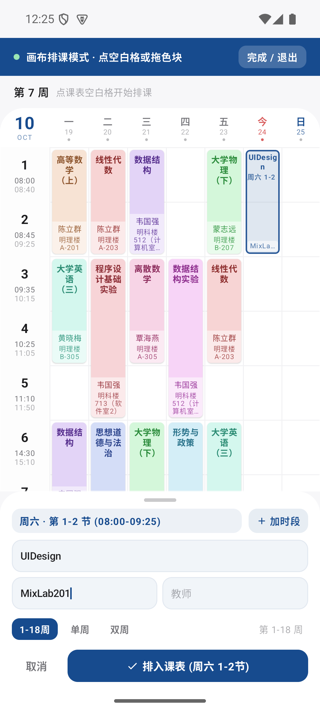 |  |

### 桌面组件

长按桌面空白处，在系统组件列表中找到泥石，添加「下一节课」或「下一节课 · 今日概览」。组件读取本地课表，点击课程可进入应用查看详情。

| 即将上课 | 正在上课 | 今天无课 |
| :---: | :---: | :---: |
| 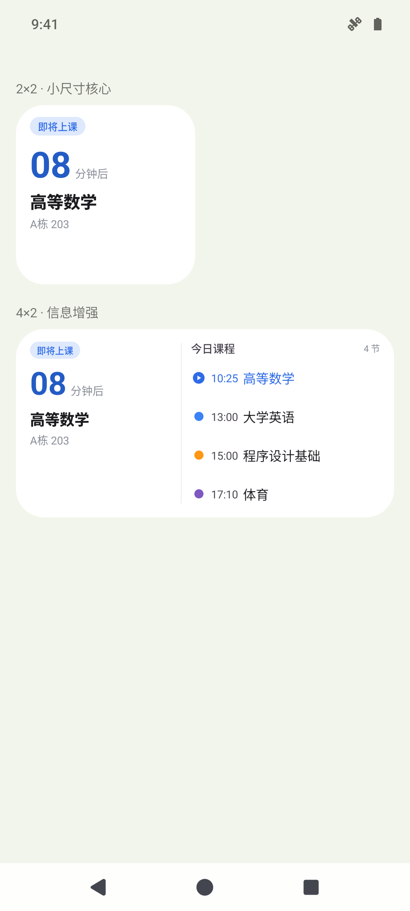 | 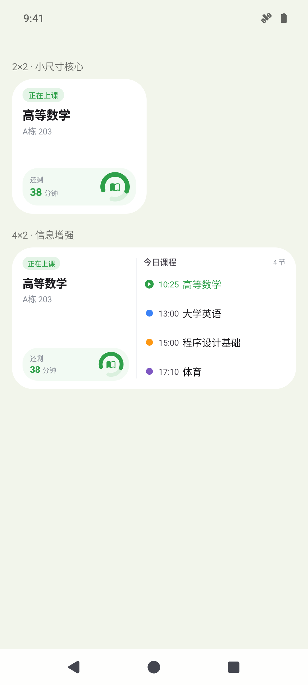 | 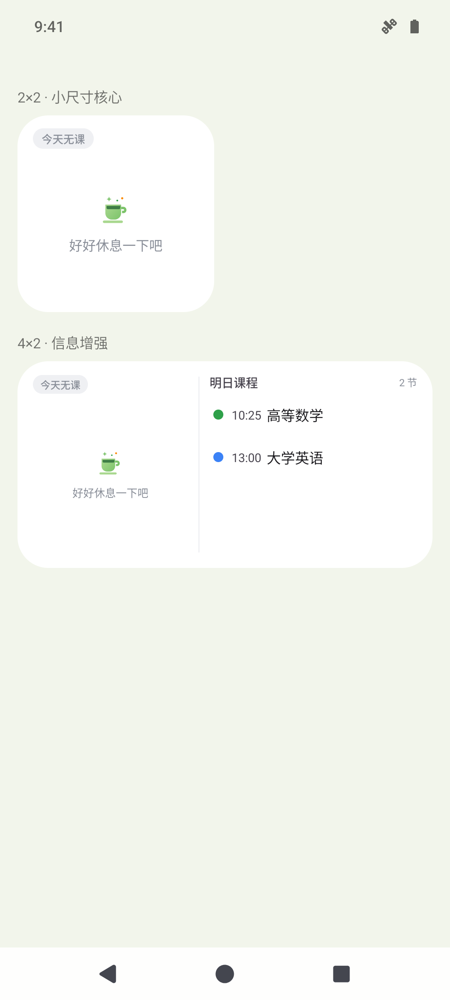 |

[查看组件的完整状态示例](docs/screenshots/widget-states.png)，包括课间、下一节课、今日课程结束及长课程名显示。

## 从源码构建

### 环境要求

以下命令在 Windows PowerShell 中执行，工作目录为项目根目录。

| 项目 | 要求 |
| --- | --- |
| JDK | 17，配置 `JAVA_HOME`，或使用 Android Studio 的 Gradle JDK 设置 |
| Android SDK | Android SDK Platform 36、Build Tools 36.0.0、Platform Tools |
| Gradle | 使用仓库内 Wrapper，版本为 8.14.3 |

用 Android Studio 打开项目并配置 SDK 路径，或在本机 `local.properties` 中设置 `sdk.dir`。首次构建需要下载 Gradle 和 Android 依赖。

### 构建与安装

```powershell
# 构建调试包
.\gradlew.bat :app:assembleDebug

# 通过 ADB 安装到已连接的设备或模拟器
adb install -r .\app\build\outputs\apk\debug\app-debug.apk
```

Debug 构建包含 `arm64-v8a` 和 `x86_64`。应用包名为 `com.fengkao.timetable`。

### 离线演示

项目提供独立的 Demo 构建，使用示例课程、饮水设备和洗衣机展示界面，无需真实账户。Demo 清单移除了网络权限，不能执行实际同步、饮水启动或洗衣支付。

```powershell
.\gradlew.bat :app:assembleDemo
adb install -r .\app\build\outputs\apk\demo\app-demo.apk
adb shell am start -S -n com.fengkao.timetable.demo/com.fengkao.timetable.demo.DemoActivity
```

演示入口支持通过 `screen` 参数选择页面，例如：

```powershell
# 查看饮水页面
adb shell am start -S -n com.fengkao.timetable.demo/com.fengkao.timetable.demo.DemoActivity --es screen water

# 查看洗衣页面
adb shell am start -S -n com.fengkao.timetable.demo/com.fengkao.timetable.demo.DemoActivity --es screen wash

# 查看初次设置中的偏好页面（步骤从 0 开始）
adb shell am start -S -n com.fengkao.timetable.demo/com.fengkao.timetable.demo.DemoActivity --es screen welcome --ei step 3
```

### 饮水服务配置

```powershell
Copy-Item .\water.properties.example .\water.properties
```

项目已内置与 life-798 客户端一致的慧生活798默认配置；如需覆盖，再复制 `water.properties.example` 为 `water.properties`：

```properties
API_GATEWAY=https://i.ilife798.com/api/v1
API_CID=drinkwaterapp123456789
```

`API_GATEWAY` 必须是有效的 HTTPS 网关，`API_CID` 为该服务对应的客户端标识。Demo 仍使用独立的演示状态，不访问真实喝水服务。

### Release 签名

```powershell
Copy-Item .\keystore.properties.example .\keystore.properties
```

将自己的密钥库放到本机，在 `keystore.properties` 中设置 `storeFile`、`storePassword`、`keyAlias` 和 `keyPassword`，然后构建：

```powershell
.\gradlew.bat :app:assembleRelease
```

输出位于 `app/build/outputs/apk/release/`。未配置有效密钥库时生成未签名 APK，需要签名后才能安装。实际服务配置、签名凭据及密钥库均不应提交到仓库。

### 测试

```powershell
.\gradlew.bat :app:testDebugUnitTest
```

现有单元测试覆盖学期与周次计算、课表缓存、初次设置进度、校园服务接口、学习通通知解析与待办归并、组件尺寸计算等逻辑。

## 项目结构

```text
app/src/main/
├── java/com/fengkao/timetable/
│   ├── data/       课表同步、学习通通知抓取、本地存储与校园服务接口
│   ├── notify/     课程笔记的精确闹钟提醒
│   ├── ui/         课程、笔记、学习通通知、喝水、洗衣、设置及统计界面
│   └── widget/     桌面组件与状态更新
└── res/            Android 资源与组件布局
app/src/demo/       离线演示入口与示例数据
app/src/test/       单元测试
docs/screenshots/   界面截图
gradle/             Wrapper 与依赖版本配置
scripts/            构建辅助脚本
```

界面使用 Kotlin、Jetpack Compose 和 Material 3；本地设置使用 DataStore，后台同步使用 WorkManager，笔记提醒使用 AlarmManager，课表默认从教务直连同步，教务网页导入使用 WebView。

## 许可证

本项目采用 [MIT License](LICENSE)。其他依赖的许可信息可在应用「我的 → 关于 → 开源许可」中查看。
